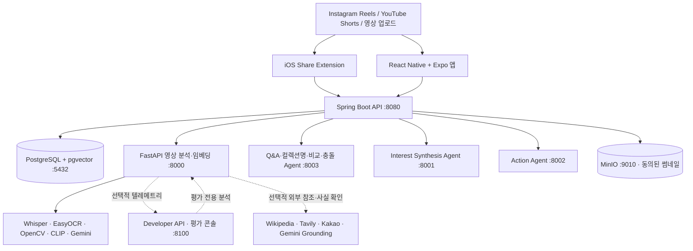

# SAVEON · save:on

**저장한 숏폼을, 필요한 순간에 다시 찾을 수 있도록.**

SAVEON은 Instagram Reels·YouTube Shorts 등에서 발견한 정보를 저장하고, AI로 분석·구조화한 뒤 **검색, 자동 컬렉션, 영상 간 비교, 저장물 기반 질의응답**으로 다시 활용할 수 있도록 돕는 모바일 앱입니다.

> **Problem** — 저장은 쉽지만, 필요한 정보를 다시 찾으려면 저장 목록을 뒤지고 영상을 재생해야 합니다.  
> **Approach** — 콘텐츠를 **저장 → 분석 → 구조화 → 연결 → 재탐색·비교·활용**하는 흐름으로 전환합니다.

**프로젝트 유형:** 2026 Capstone Design / 팀 프로젝트  
**코드 기준:** GitHub `main` 브랜치, 2026-11-20 기준 (`35702e5`, PR #3 병합)  
**범위:** 이 README는 코드에 구현된 기능을 설명하며, 모든 외부 서비스·영상에서의 작동이나 정확도를 보증하지 않습니다.

<!-- 실제 앱 이미지/시연 GIF가 준비되면 이 아래에 삽입하세요. 민감정보와 타인의 개인정보를 제거한 캡처만 사용하세요. -->

---

## 1. 프로젝트 배경과 목표

숏폼에는 제품 리뷰, 맛집, 여행지, 레시피, 생활 팁처럼 나중에 다시 확인할 정보가 많습니다. 그러나 기존 저장 방식은 영상 **링크를 모아 두는 것**과 영상 속 **정보를 다시 찾는 것** 사이에 간극이 있습니다.

- 저장한 영상이 많아질수록 원하는 항목을 찾기 어렵습니다.
- 검색할 단어가 기억나지 않거나 영상 제목만으로는 내용을 구분하기 어렵습니다.
- 같은 주제에 관한 여러 영상의 공통점과 상충되는 정보를 다시 재생하며 비교해야 합니다.

SAVEON은 개별 영상의 요약을 제공하는 것에 그치지 않고 **저장된 콘텐츠 전체를 재탐색 가능한 지식 보관함으로 만드는 것**을 목표로 합니다.

## 2. 주요 사용자 기능

### 2.1. 공유·저장과 비동기 분석

- Instagram Reels 및 YouTube URL을 앱에 붙여넣거나 **iOS Share Extension**으로 공유하여 저장합니다.
- 중복 원본 URL은 정규화된 식별자로 판별하여 동일한 항목을 반복 생성하지 않도록 합니다. 기존 항목의 분석이 실패한 경우에는 재분석을 시도할 수 있습니다.
- Spring Boot가 저장 요청을 접수한 후 별도 작업으로 AI 분석을 진행하며, 앱에서는 분석 상태·단계를 확인할 수 있습니다.
- 영상 파일 직접 업로드 기능도 있습니다.
- Instagram Reel 대표 이미지는 사용자가 **저장·표시 권한을 명시적으로 확인한 경우에만** 프레임에서 추출하고 비공개 스토리지에 저장하도록 요청합니다. YouTube 썸네일과는 처리 방식이 다릅니다.

### 2.2. 멀티모달 영상 분석과 구조화

분석 가능한 영상에 대해 다음 정보를 조합합니다.

- **STT · faster-whisper:** 영상의 음성·발화 내용 추출
- **OCR · EasyOCR / OpenCV:** 화면 속 자막·텍스트와 등장 시점 추출
- **Vision · CLIP:** 시각적 단서 보조 분석
- **Gemini:** 제목, 요약, 카테고리, 키워드, 대상별 엔티티·상세 정보 및 절차 구조화
- **Evidence 연결:** 가능한 범위에서 추출 정보와 영상의 STT/OCR 근거 ID 연결

프롬프트 실험용 변형은 `baseline`, `few_shot_v1`, `structured_v2`로 제공됩니다. 현재 AI API에서 별도 변형을 지정하지 않는 일반 분석 요청은 **`structured_v2`를 기본값**으로 사용하도록 구현돼 있으며 `DEFAULT_PROMPT_VARIANT` 설정으로 바꿀 수 있습니다. 실제 모델 응답은 입력 영상 및 서비스 상태에 따라 달라집니다.

### 2.3. 저장물 검색과 RAG 질의응답

- 제목·키워드 검색 및 Gemini 임베딩과 **PostgreSQL pgvector**를 활용한 의미 검색
- 자연어 질문과 관련된 저장물을 검색한 뒤 해당 저장물을 근거로 답변하는 **Retrieval-Augmented Generation(RAG)** 방식
- 답변과 연관된 출처 영상 표시 및 원본 이동
- 에이전트 응답에 문제가 생기면, 생성 답변을 단정하지 않고 관련 저장물을 확인할 수 있도록 안내하는 대체 응답

예시 질문: *“전에 저장한 성수 카페 중 빵이 유명하다고 했던 곳은?”*

### 2.4. 스마트 컬렉션과 영상 비교

- 서로 다른 **2개 이상의 저장물**에 반복 등장하는 제목·키워드·엔티티 등의 근거를 이용해 관련 영상을 **자동 주제별로 묶습니다**.
- 광범위한 카테고리나 임베딩 유사도 **하나만**으로 무관한 영상을 강제로 묶지 않도록 제한합니다.
- 컬렉션명과 소개 문구는 Q&A 에이전트를 통해 생성할 수 있고, 실패 시 규칙 기반 표현을 사용합니다.
- 비교 가능한 저장물에서는 **공통점 / 엇갈리는 점 / 영상별 고유 정보**를 근거 영상과 함께 정리합니다.
- 명시적인 가격·날짜 등 객관 정보의 차이는 조건에 맞는 경우 외부 정보를 확인할 수 있습니다. 확인 결과는 원본 영상의 주장과 **분리하여** 표시합니다.

> 비교 결과는 구매·방문 등의 결정을 대신하는 추천이 아니라, 사용자가 저장한 자료를 검토하기 쉽게 정리한 것입니다. 같은 브랜드라는 이유만으로 다른 제품의 가격을 충돌로 판단하지 않도록 검증 로직을 두었습니다.

### 2.5. 콘텐츠 연결과 관심 정보 묶음

- 구조화 분석에서 추출한 **PLACE / PRODUCT / BRAND / PERSON / SERVICE** 엔티티를 바탕으로 관련 저장물을 연결합니다.
- 반복 엔티티를 누르면 연관 콘텐츠, 공통 키워드·태그, 다른 연관 엔티티, 영상별 요약이 포함된 **관심 정보 묶음(Content Bundle)**을 확인할 수 있습니다.
- **Interest Synthesis Agent**는 여러 저장물에서 반복되는 관심사와 시사점을 종합합니다. 에이전트가 이용 불가한 경우 규칙 기반 묶음으로 대체됩니다.

### 2.6. Action Agent: 정보에서 행동으로

저장된 영상에서 추출한 장소·제품·날짜·절차 정보가 충분할 경우 다음 행동을 제안합니다.

- 장소 → 지도 검색
- 상품·브랜드 → 비교 검색 및 웹 검색
- 명시적인 날짜 → 일정 확인 후 캘린더 추가
- 레시피·방법 → 앱 내 체크리스트 생성

단일 영상과 여러 영상을 묶은 Content Bundle 모두를 대상으로 하며, **근거와 조건이 부족하면 해당 행동을 제안하지 않도록** 설계했습니다. Agent 장애 시에는 일부 규칙 기반 행동을 제공합니다. 캘린더 등 외부 작업은 앱에서 사용자의 확인을 거쳐 실행됩니다.

### 2.7. 추가 편의·품질 기능

| 기능 | 설명 |
| --- | --- |
| **AI 결과 수정** | 제목·요약·카테고리·키워드·엔티티 정보의 사용자 수정 및 수정 이력 기록 |
| **Canonical Entity** | 사용자가 수정한 엔티티 이름·타입을 표준화 데이터로 보존하고 이후 분석 결과 보정에 활용 |
| **AI 결과 품질 확인** | 낮은 신뢰도의 엔티티, 엔티티 타입 불일치, 부정확한 날짜 등 규칙 기반 경고 |
| **콘텐츠 충돌 탐지** | 여러 저장물이 같은 대상에 관해 다르게 말하는 가격·일정 등 비교 후보 표시. 근거 부족 시 충돌로 단정하지 않음 |
| **관심사 타임라인** | 최근 7일·이전 7일·최근 30일 저장 패턴과 관심사 변화 집계 |
| **스마트 리마인더** | 최근 저장 이력과 날짜·행사·여행 관련 단서로 앱에서 다시 살펴볼 콘텐츠 제안. 푸시 알림 서비스와는 구분됨 |
| **추가 출처 링크** | 설정과 검색 결과에 따라 관련 링크 또는 교육 콘텐츠의 참고 자료를 표시. 링크의 존재가 곧 사실 검증은 아님 |

## 3. 내부 개발·평가 도구

사용자 앱과 별도로 개발 과정의 품질 확인을 위한 기능이 구현돼 있습니다.

- **Developer API / Console (`developer-api/`, 기본 포트 `8100`)**: 분석 트레이스·단계·실패·지연 등의 수집 및 조회. 텔레메트리는 선택적으로 활성화합니다.
- **평가 워크스페이스 (`evaluation/`)**: 영상 분석 평가 항목, 주석 가이드, 프롬프트 변형 비교 및 재현 실험 스크립트
- **개발자 평가 콘솔**: 기존 결과와 새 분석 실행 비교, 사람 검토 기록, 프롬프트 후보 실험, AI 리뷰 초안, 기존 저장물에 검토된 분석 결과 반영
- **실험과 운영의 분리**: 평가만을 위한 분석은 기본적으로 일반 앱 보관함에 새 콘텐츠를 생성하지 않습니다. 기존 보관함 반영은 별도 선택·인증 절차를 사용합니다.

> 평가 데이터와 AI 생성 정답 초안에는 **사람이 검토하지 않은 `DRAFT` 항목**이 있습니다. 이를 검증된 정답이나 모델 정확도 수치로 소개하면 안 됩니다. 일부 전후 실험에서는 OCR 설정과 프롬프트가 동시에 변경됐으므로, 성능 변화를 특정 원인 하나에 귀속할 수도 없습니다.

## 4. 시스템 아키텍처



**데이터 흐름:** URL 저장 → DB 접수 → 비동기 AI 분석 → 구조화 정보·임베딩 저장 → 컬렉션/연결/검색/비교/RAG에 재사용.

**서비스 분리:** `8001`, `8002`, `8003`은 주요 에이전트 기능을 위한 개별 FastAPI 프로세스입니다. 미실행 시 기능별로 규칙 기반 결과나 오류 안내가 나타날 수 있습니다. `8100`은 일반 사용자 앱 실행에 필수인 서버가 아니라 내부 평가·관측용 서버입니다.

## 5. 기술 스택

| 계층 | 기술 |
| --- | --- |
| Mobile | React Native 0.81, Expo SDK 54, TypeScript, iOS Share Extension |
| API | Java 21, Spring Boot 4, Spring Data JPA, Hibernate |
| AI / Agent | Python, FastAPI, Gemini API |
| Multimodal | faster-whisper, EasyOCR, OpenCV, CLIP / Transformers |
| Semantic Retrieval | Gemini Embedding, PostgreSQL, pgvector |
| Thumbnail Storage | MinIO |
| Developer Tools | FastAPI, SQLAlchemy, 로컬 SQLite(기본), 평가 콘솔 |
| Development | Docker Compose, Git, GitHub, Gradle, Xcode |

현재 저장소의 Docker Compose 구성에는 PostgreSQL/pgvector와 MinIO가 포함되어 있습니다. **Redis는 현행 필수 실행 구성에 포함돼 있지 않습니다.**

## 6. 저장소 구조

```text
saveon/
├── mobile/         # React Native 앱, 공유 확장, 화면/UI/API 클라이언트
├── api/            # Spring Boot API, 엔티티/컬렉션/검색/비교/품질 기능
├── ai/             # 영상 분석 파이프라인, 임베딩, 3개 Agent 서비스
├── developer-api/  # 내부 텔레메트리·평가 API 및 콘솔
├── evaluation/     # 프롬프트/분석 결과 평가용 자료와 스크립트
├── docs/           # 개발·실험 문서
└── scripts/        # Windows PowerShell 실행/검증 보조 스크립트
```

## 7. 로컬 개발 실행 (macOS / iPhone)

**사전 준비:** Git, Docker Desktop, Java 21, Python 3, Node.js/npm, Xcode 및 iOS 개발용 서명 환경. 프로젝트에 접근 가능한 GitHub 권한과 Gemini API 키가 필요합니다. 아래 명령어는 **저장소 루트에서 시작**한다고 가정합니다.

### 7-1. 설치 및 DB/스토리지

```bash
git clone https://github.com/yewongim156-source/saveon.git
cd saveon

# Docker Desktop을 켠 후
cd api
docker compose up -d
docker compose ps
cd ..
```

- PostgreSQL: `localhost:5432`
- MinIO API: `localhost:9010` / 콘솔: `localhost:9011`
- 로컬 개발 기본 자격증명은 `api/docker-compose.yml`에서 확인할 수 있습니다. 외부 공개 환경에서 그대로 사용하지 마세요.

### 7-2. AI 서비스 준비

```bash
cd ai
python3 -m venv .venv
source .venv/bin/activate
python -m pip install -r requirements.txt
[ -f .env ] || cp .env.example .env
```

`ai/.env`에 본인의 `GEMINI_API_KEY`를 설정하세요. `.env`는 Git에 올리지 않습니다. 초기에 Whisper/OCR/CLIP 모델 파일 다운로드가 발생할 수 있습니다.

**아래 서버는 각각 다른 터미널에서 실행합니다.** 각 터미널은 저장소 루트에서 시작한다고 가정합니다.

| 포트 | 용도 | `ai/` 디렉터리에서 실행 |
| --- | --- | --- |
| `8000` | 영상 분석·임베딩 | `python -m uvicorn main:app --reload --port 8000` |
| `8001` | Interest Synthesis Agent | `python -m uvicorn interest_agent:app --reload --port 8001` |
| `8002` | Action Agent | `python -m uvicorn action_agent:app --reload --port 8002` |
| `8003` | Q&A·스마트 컬렉션·비교·충돌 Agent | `python -m uvicorn qna_agent:app --reload --port 8003` |

각 터미널에서 `cd ai && source .venv/bin/activate` 후 해당 명령어를 실행합니다. 폴더 이동은 현재 터미널 위치에 맞게 조정하세요.

### 7-3. Spring Boot API

새 터미널에서:

```bash
cd api
./gradlew bootRun
```

기본 API 주소: `http://localhost:8080/api/v1`. PostgreSQL이 준비된 후 실행하세요. `api/src/main/resources/application.properties`는 로컬 개발용 DB 연결을 가정합니다.

### 7-4. 모바일 앱 및 iOS 공유 확장

새 터미널에서:

```bash
cd mobile
npm ci
[ -f .env ] || cp .env.example .env
npx expo run:ios --device
```

실제 iPhone에서는 `mobile/.env`에 **휴대폰에서 접근 가능한 API 서버 주소**를 지정해야 합니다.

```dotenv
# 예시 — 실제 Mac의 같은 네트워크 IP 또는 접근 가능한 HTTPS 주소로 변경
EXPO_PUBLIC_API_BASE_URL=http://192.168.0.10:8080/api/v1
```

기존 Development Build 설치 후 JavaScript만 갱신할 때는 `npx expo start --dev-client -c`를 사용할 수 있습니다. **iOS Share Extension이나 네이티브 설정을 변경했을 때는 네이티브 재빌드가 필요합니다.** Expo Go만으로는 이 프로젝트의 iOS 공유 확장을 그대로 테스트할 수 없습니다.

> iPhone의 `localhost`는 Mac을 가리키지 않습니다. Mac에서 서버를 구동하는 로컬 시연은 서버가 실행 중이고 iPhone이 해당 네트워크/API에 접근 가능해야 합니다. 기기 및 네트워크에 따라 개발용 서명·방화벽·HTTP 연결 설정을 점검하세요.

### 7-5. 선택: 내부 Developer API

```bash
cd developer-api
python3 -m venv .venv
source .venv/bin/activate
python -m pip install -r requirements.txt
[ -f .env ] || cp .env.example .env
python -m uvicorn main:app --reload --port 8100
```

내부 콘솔 주소: `http://localhost:8100/evaluations` (평가), 관리용 API는 `/admin/...`. 평가 결과를 일반 보관함에 반영하는 기능에는 별도 인증 토큰 구성이 필요합니다.

## 8. 주요 API 예시

| 메서드 | 경로 | 용도 |
| --- | --- | --- |
| `POST` | `/api/v1/contents` | 영상 URL 저장 및 분석 접수 |
| `GET` | `/api/v1/contents/{id}/progress` | 분석 상태·진행 단계 |
| `GET` | `/api/v1/contents/search/semantic` | 저장물 의미 검색 |
| `POST` | `/api/v1/knowledge/ask` | 저장물 기반 Q&A |
| `GET` | `/api/v1/smart-collections` | 스마트 컬렉션 목록 |
| `POST` | `/api/v1/collection-comparisons` | 저장 영상 비교 |
| `GET` | `/api/v1/content-connections` | 반복 엔티티 연결 |
| `GET` | `/api/v1/content-connections/bundle` | 관심 정보 통합 묶음 |
| `POST` | `/api/v1/content-actions/plan/content/{id}` | 단일 영상 행동 제안 |
| `GET` | `/api/v1/content-conflicts` | 충돌 정보 후보 |
| `GET` | `/api/v1/interest-timeline` | 저장 패턴·관심사 변화 |
| `GET` | `/api/v1/smart-reminders` | 다시 볼 콘텐츠 제안 |
| `GET` | `/api/v1/content-quality/{id}` | 분석 결과 품질 경고 |
| `POST` | `/api/v1/ai-corrections/content/{id}` | 분석 결과 사용자 수정 |

API 입력·출력 구조와 세부 제약은 `api/src/main/java/com/saveon/api/`의 Controller/DTO에서 확인하세요.

## 9. 테스트 및 검증

```bash
# AI 단위 테스트 — ai/에서
source .venv/bin/activate
python -m unittest discover -s tests -v

# Spring Boot 테스트 — api/에서 (PostgreSQL 실행 필요)
./gradlew test

# 모바일 타입 검사 — mobile/에서
npx tsc --noEmit
```

**프로젝트 통합 점검 기록 (2026-11-20):** 사용자가 로컬에서 AI 단위 테스트 99개 통과를 확인했고, Spring Boot 테스트 및 실제 iPhone 주요 기능(공유·썸네일·분석·컬렉션·비교·검색)의 정상 동작을 확인했습니다. 이는 해당 환경에서 수행한 점검 결과이며, **현행 `main`의 전체 회귀 테스트·성능·정확도에 대한 독립 인증은 아닙니다.**

## 10. 제약·운영 유의사항

- Instagram/YouTube에서 **비공개·로그인 필요·삭제·지역 제한** 영상은 접근 또는 분석이 제한될 수 있습니다. 외부 플랫폼의 서비스 정책을 준수해야 합니다.
- 영상에서 추출한 텍스트·사용자 후기·모델 요약은 원본의 **주장 또는 추론**일 수 있으며, 공식 사실과 구분해야 합니다.
- **영상별 외부 사실 검증은 기본 비활성화**(`FACT_CHECK_ENABLED=false`)입니다. 활성화해도 제공자 설정·요금·쿼터·근거 품질에 영향을 받습니다. 컬렉션 비교의 외부 조회는 별도 조건에서 시도될 수 있습니다.
- AI 요약·엔티티/태그/비교 결과는 불완전할 수 있어 오류 수정·출처 확인 기능을 제공합니다.
- Instagram 썸네일은 명시적인 권한 확인 및 추출·저장 성공 시에만 표시됩니다. **이미 같은 원본 URL이 저장되어 있으면 중복 방지 로직이 기존 항목을 반환하므로, 뒤늦게 재공유하며 동의해도 썸네일이 자동 추가되지 않을 수 있습니다.** 타인의 저작물 이용 및 재배포 권리는 별도로 확인해야 합니다.
- 개발자 평가 항목과 AI 생성 정답 초안 중 일부는 `DRAFT`로, 사람 검증이 완료된 정량 정확도 데이터가 아닙니다.
- 개발용 API/스토리지 설정에는 로컬 전용 값이 포함되어 있습니다. **인증·접근 통제·비밀값 관리·HTTPS 등은 별도의 배포 보안 작업이 필요**합니다. 현재 로컬 개발 구성을 곧바로 공개 서비스에 배포하지 마세요.

---

**SAVEON — Save it once. Find it when it matters.**
